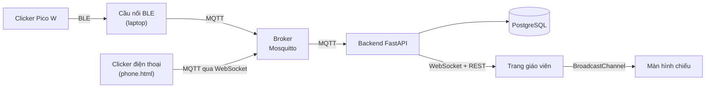

# Phòng Thi Clicker: Hệ thống phản hồi lớp học IoT

Hệ thống trả lời trắc nghiệm cho lớp học tối đa 60 sinh viên. Mỗi sinh viên trả lời câu hỏi trắc
nghiệm bằng một clicker Raspberry Pi Pico W; giáo viên điều khiển bài kiểm tra trên trang web và
xem đáp án, điểm số, thống kê theo thời gian thực. Toàn bộ hệ thống chạy trên một laptop, không cần
Internet (trừ bước AI tóm tắt kết quả, không bắt buộc).

Đồ án môn IoT, 2026.

## Thành viên nhóm

- Hồ Ngọc Huy               -     23134024
- Phan Văn Khải             -     23134028
- Biện Lê Xuân Khoa         -     23134029
- Đoàn Nguyễn Anh Khoa      -     23134030
- Nguyễn Xuân Đăng Khoa     -     23134031

## Cách hoạt động



1. Giáo viên mở câu hỏi. Backend phát trạng thái lên MQTT; cầu nối chuyển thành lệnh `MODE_3`
   gửi tới mọi clicker.
2. Sinh viên chọn đáp án và bấm ENTER. Clicker gửi JSON qua BLE; cầu nối đẩy lên MQTT.
3. Backend lưu tin nhắn thô, kiểm tra (đã đăng ký chưa? còn hạn không? đã trả lời chưa?), khóa đáp
   án xác nhận đầu tiên và gửi xác nhận (ack) về đúng clicker đó. Clicker chỉ hiện "đã khóa" khi
   nhận được ack.
4. Trang giáo viên nhận sự kiện trực tiếp qua WebSocket. Khi câu hỏi đóng, trang hiện đúng/sai,
   thống kê và phân bố điểm.

**Thiết kế trong một câu:** mỗi thành phần làm một việc và nói chuyện với nhau qua giao thức chuẩn
(BLE, MQTT, HTTP, WebSocket). Backend là nơi quyết định duy nhất; thiết bị chỉ hiển thị những gì
backend đã xác nhận. Chi tiết trong [`backend/DECISIONS.md`](backend/DECISIONS.md).

## Tính năng

- **Đề thi:** soạn trên trang hoặc nhập từ CSV/Excel; thời gian làm bài và thời gian xem đáp án
  cho từng câu hoặc cả đề; chuyển câu tự động hoặc thủ công.
- **Danh sách lớp:** nhập từ Excel; chỉ sinh viên có trong danh sách mới đăng ký được.
- **Thiết bị:** tối đa 60 clicker (Pico W qua BLE, hoặc điện thoại); xóa một hoặc tất cả thiết bị
  trong lúc đăng ký.
- **Đáp án tin cậy:** đáp án xác nhận đầu tiên được khóa; tin gửi lại sau khi mất sóng được nhận ra
  nhờ số thứ tự và không bao giờ bị đếm hai lần; đồng hồ duy nhất là của server.
- **Bảng theo dõi trực tiếp** cho giáo viên và **màn hình chiếu** riêng cho cả lớp.
- **Kết quả:** % đúng từng câu, phân bố đáp án, bảng xếp hạng, phân bố điểm, xuất Excel.
- **Khiếu nại / nhập tay:** lưu riêng, không ghi đè dữ liệu thiết bị gửi; thống kê tự cập nhật.
- **AI tóm tắt** kết quả (Gemini hoặc Claude). Khóa API chỉ nằm trên server và không gửi tên sinh
  viên.
- **Đăng nhập giáo viên:** mật khẩu được băm, khóa tài khoản tạm thời khi nhập sai nhiều lần.

## Cấu trúc thư mục

| Đường dẫn | Nội dung |
|---|---|
| [`backend/`](backend/) | Server (FastAPI), CSDL (SQL), trang web, cầu nối BLE, công cụ kiểm thử: **bắt đầu từ đây** |
| [`backend/web/`](backend/web/) | Trang giáo viên `index.html`, `projector.html`, clicker điện thoại `phone.html` / `phone_ble.html` |
| [`backend/scripts/`](backend/scripts/) | `ble_bridge.py` (clicker ↔ MQTT), `fake_devices.py` (lớp học giả lập), `demo_run.py` (kiểm tra đầu cuối) |
| [`backend/sql/`](backend/sql/) | `schema.sql`, `seed.sql`, toàn bộ truy vấn (`queries.sql`), migration |
| `ble_receiver.py`, `mock_pico.py`, `BLE_receiver_tutorial.txt` | Bộ nhận BLE của nhóm phần cứng và mô phỏng Pico trên laptop |

## Chạy nhanh (Windows)

Cần **Docker Desktop** (đang chạy) và **Python 3.12+**.

```powershell
cd backend
copy .env.example .env
.\start.ps1
```

`start.ps1` khởi động CSDL, broker và backend, chuẩn bị CSDL, rồi mở trang giáo viên tại
**http://127.0.0.1:8000/** cùng 50 clicker giả lập. Đăng nhập bằng **GV001 / 123456**. Dừng tất cả
bằng `.\stop.ps1`.

Với clicker thật: `.\start.ps1 -Pico -PicoIds 7`, trong đó `7` là số của Pico. Thiết bị giả lập sẽ
bỏ qua số này. Toàn bộ tùy chọn có trong [`backend/README.md`](backend/README.md).

## Công nghệ

| Thành phần | Công nghệ | Lý do |
|---|---|---|
| Clicker | Raspberry Pi Pico W, MicroPython, BLE | Có sẵn Bluetooth, tiết kiệm điện, không cần router |
| Truyền tin | MQTT, Mosquitto | Chuẩn IoT nhẹ; publish/subscribe tách thiết bị khỏi server |
| Backend | Python, FastAPI, asyncio | Một tiến trình xử lý REST, WebSocket và MQTT cùng lúc |
| CSDL | PostgreSQL 16 | Ràng buộc chặn dữ liệu sai ngay từ gốc; view tính sẵn thống kê |
| Web | HTML/JavaScript (không cần build) | Backend phục vụ trực tiếp, chạy không cần Internet |
| Triển khai | Docker Compose | Một lệnh; cùng cấu hình chạy trên laptop hay server |

## Kiểm thử

| Kiểm tra | Kết quả |
|---|---|
| Unit test (`pytest`): quy tắc, máy trạng thái, đăng nhập | 56/56 |
| Demo đầu cuối (`scripts/demo_run.py`): REST + MQTT + WebSocket | 53/53 |
| 50 clicker giả lập, 8 kịch bản (gửi dồn, mất gói, khởi động lại, trả lời muộn…) | Không mất, không trùng đáp án nào; cả 50 nhận ack trong 0,42 s khi gửi cùng lúc |
| Pico W thật qua cầu nối BLE | Đăng ký, trả lời, khóa và ack hoạt động |

Xem [`backend/TESTING_DEVICES.md`](backend/TESTING_DEVICES.md).

## Tài liệu

- [`backend/README.md`](backend/README.md): cách chạy, cấu hình, tham chiếu API và MQTT, xử lý lỗi
- [`backend/WALKTHROUGH.md`](backend/WALKTHROUGH.md): giải thích code từng file
- [`backend/DECISIONS.md`](backend/DECISIONS.md): các quyết định thiết kế và lý do
- [`backend/BLE_BRIDGE.md`](backend/BLE_BRIDGE.md): kết nối clicker thật
- [`backend/TESTING_DEVICES.md`](backend/TESTING_DEVICES.md): thiết bị giả lập, điện thoại, kịch bản kiểm thử
- [`backend/web/INTEGRATION_GUIDE.md`](backend/web/INTEGRATION_GUIDE.md): cách trang giáo viên giao tiếp với backend

## Giấy phép

Apache License 2.0, xem [`LICENSE`](LICENSE).
