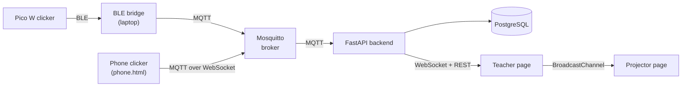

# Phòng Thi Clicker: IoT Audience Response System

A classroom response system for up to 60 students. Each student answers multiple-choice
questions on a Raspberry Pi Pico W clicker; the teacher runs the quiz from a web page and
sees answers, scores and statistics live. Everything runs on one laptop, with no internet
required (except for the optional AI summary of the results).

IoT course project, 2026.

## How it works



1. The teacher opens a question. The backend publishes the state on MQTT; the bridge turns it
   into a `MODE_3` command for every clicker.
2. A student picks an answer and presses ENTER. The clicker sends JSON over BLE; the bridge
   publishes it on MQTT.
3. The backend stores the raw message, checks it (registered? deadline? already answered?),
   locks the first confirmed answer and sends an acknowledgement back to that clicker.
   The clicker shows "locked" only when that acknowledgement arrives.
4. The teacher page receives live events over WebSocket. When the question closes it shows
   right and wrong answers, statistics and the score distribution.

**Design in one line:** every part does one job and talks to the others through standard
protocols (BLE, MQTT, HTTP, WebSocket). The backend is the only place that decides; devices only
display what it confirms. More in [`backend/DECISIONS.md`](backend/DECISIONS.md).

## Features

- **Quizzes:** write them on the page or import CSV/Excel; time limit and review delay per
  question or for the whole quiz; automatic or manual move to the next question.
- **Class lists:** import from Excel; only students on the list can register.
- **Devices:** up to 60 clickers (Pico W over BLE, or phones); remove one or all during registration.
- **Reliable answers:** the first confirmed answer is locked; resends after a lost signal are
  recognised by sequence number and never counted twice; the server is the only clock.
- **Live board** for the teacher and a separate **projector** screen for the class.
- **Results:** % correct per question, answer distribution, ranking, score distribution,
  Excel export.
- **Complaints / manual entry:** stored separately from what the device sent; statistics update.
- **AI summary** of the results (Gemini or Claude). The API key stays on the server and
  student names are not sent.
- **Teacher login** with hashed passwords and a lockout after repeated failures.

## Repository layout

| Path | Contents |
|---|---|
| [`backend/`](backend/) | Server (FastAPI), database (SQL), web pages, BLE bridge, test tools: **start here** |
| [`backend/web/`](backend/web/) | Teacher page `index.html`, `projector.html`, phone clickers `phone.html` / `phone_ble.html` |
| [`backend/scripts/`](backend/scripts/) | `ble_bridge.py` (clickers ↔ MQTT), `fake_devices.py` (simulated class), `demo_run.py` (end-to-end check) |
| [`backend/sql/`](backend/sql/) | `schema.sql`, `seed.sql`, all queries (`queries.sql`), migrations |
| `ble_receiver.py`, `mock_pico.py`, `BLE_receiver_tutorial.txt` | Hardware team's BLE receiver and a laptop simulation of the Pico |

## Quick start (Windows)

You need **Docker Desktop** (running) and **Python 3.12+**.

```powershell
cd backend
copy .env.example .env
.\start.ps1
```

`start.ps1` starts the database, broker and backend, prepares the database, and opens the
teacher page at **http://127.0.0.1:8000/** with 50 simulated clickers. Log in with
**GV001 / 123456**. Stop everything with `.\stop.ps1`.

With real clickers: `.\start.ps1 -Pico -PicoIds 7`, where `7` is your Pico's number. The fake
devices then skip that number. All options are in [`backend/README.md`](backend/README.md).

## Tech stack

| Part | Technology | Why |
|---|---|---|
| Clicker | Raspberry Pi Pico W, MicroPython, BLE | Built-in Bluetooth, low power, no router needed |
| Messaging | MQTT, Mosquitto | Lightweight IoT standard; publish/subscribe decouples devices from the server |
| Backend | Python, FastAPI, asyncio | One process handles REST, WebSocket and MQTT at the same time |
| Database | PostgreSQL 16 | Constraints reject bad data at the source; views compute the statistics |
| Web | HTML/JavaScript (no build step) | Served by the backend, works offline |
| Deployment | Docker Compose | One command; the same setup runs on a laptop or a server |

## Testing

| Check | Result |
|---|---|
| Unit tests (`pytest`): rules, state machine, auth | 56/56 |
| End-to-end demo (`scripts/demo_run.py`): REST + MQTT + WebSocket | 53/53 |
| 50 simulated clickers, 8 scenarios (burst, packet loss, reboot, late answers…) | 0 lost or duplicated answers; all 50 acknowledged within 0.42 s when sending at the same instant |
| Real Pico W through the BLE bridge | Registration, answers, lock and acknowledgement working |

See [`backend/TESTING_DEVICES.md`](backend/TESTING_DEVICES.md).

## Documentation

- [`backend/README.md`](backend/README.md): running, configuration, API and MQTT reference, troubleshooting
- [`backend/WALKTHROUGH.md`](backend/WALKTHROUGH.md): how the code works, file by file
- [`backend/DECISIONS.md`](backend/DECISIONS.md): design decisions and why
- [`backend/BLE_BRIDGE.md`](backend/BLE_BRIDGE.md): connecting the real clickers
- [`backend/TESTING_DEVICES.md`](backend/TESTING_DEVICES.md): simulated devices, phones, test scenarios
- [`backend/web/INTEGRATION_GUIDE.md`](backend/web/INTEGRATION_GUIDE.md): how the teacher page talks to the backend

## License

Apache License 2.0, see [`LICENSE`](LICENSE).
